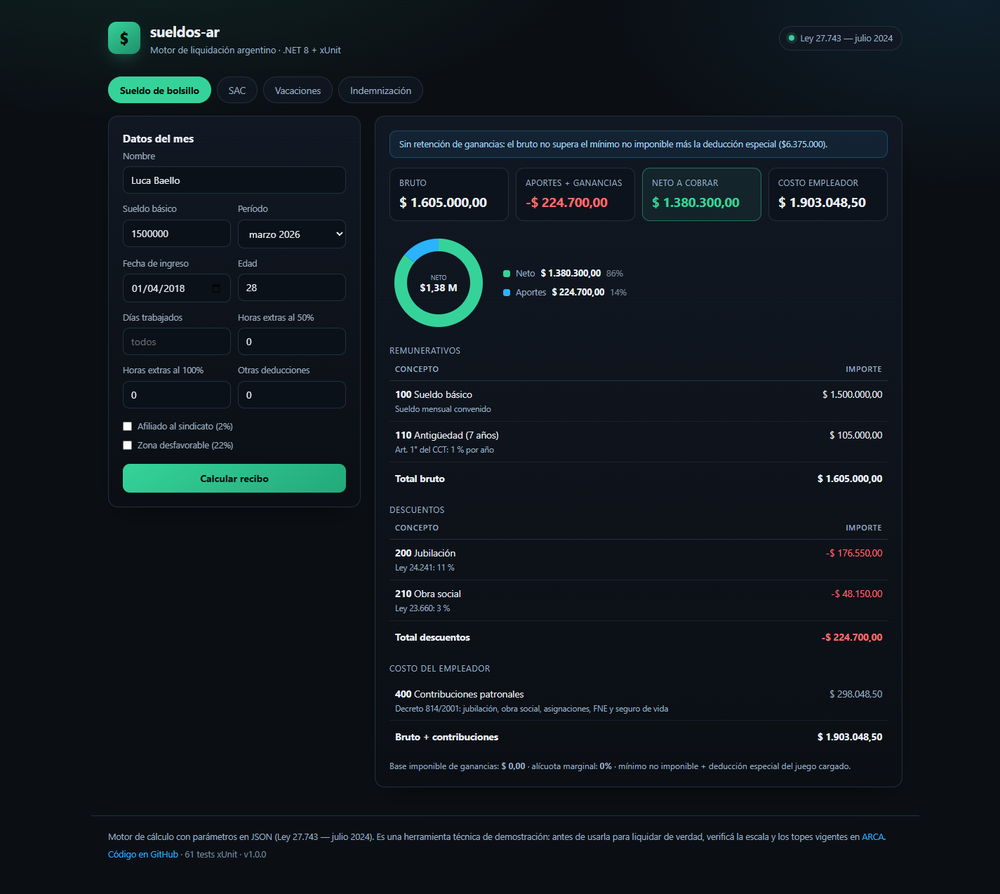
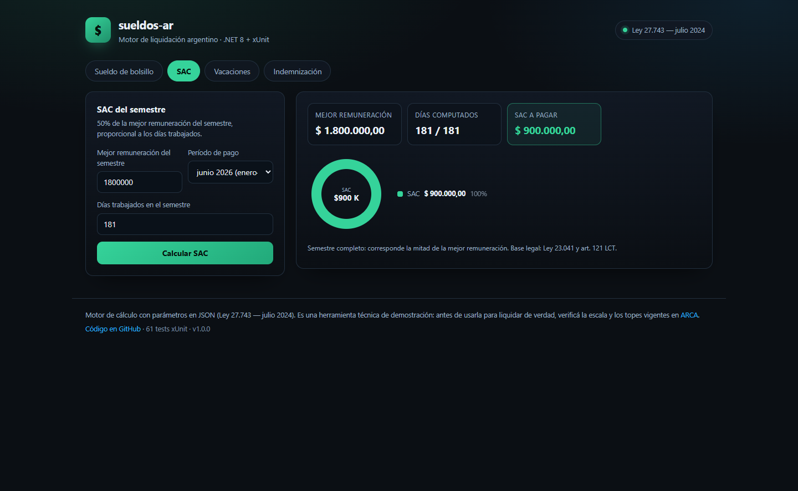
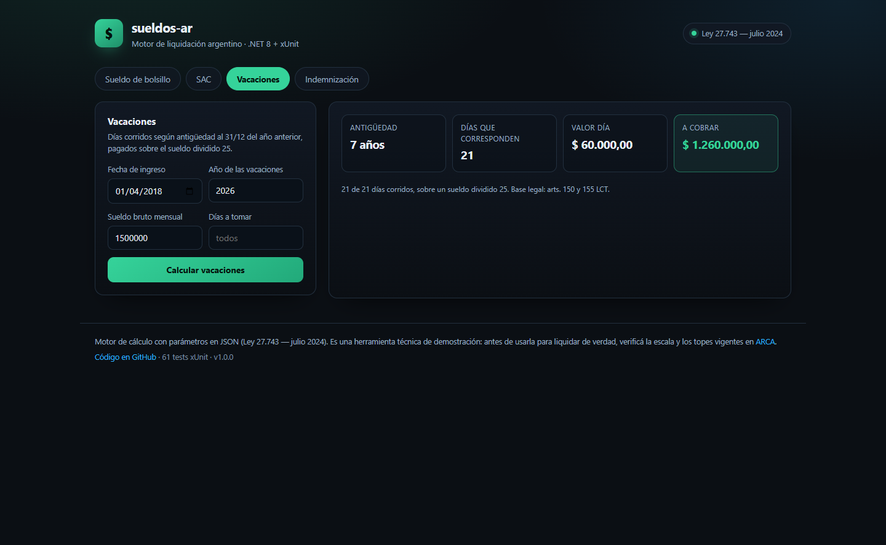
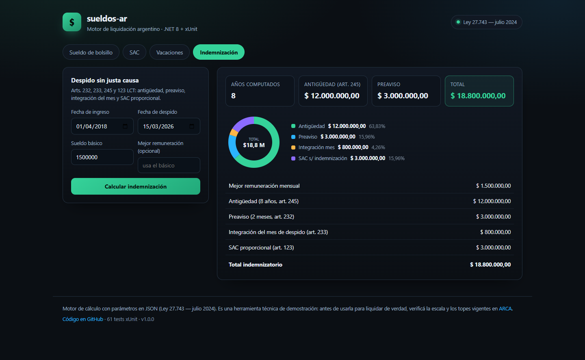

# sueldos-ar

**Motor de liquidación de sueldos argentino, en .NET 8, con tests de verdad.** SAC, vacaciones,
aportes, contribuciones, ganancias e indemnizaciones, con la base legal de cada concepto y una UI
mínima para verlo funcionar.

[](https://github.com/lucabaello1998/sueldos-ar/actions/workflows/ci.yml)


> Nació de haber trabajado en un sistema de liquidación real. **Las reglas que están acá son
> legislación pública argentina**: no hay una línea de código, un dato ni una regla del cliente.

---

## Qué hace

Una API y una pantalla que liquidan un mes completo y explican **cada peso**:

| Concepto | Qué calcula | Base legal |
|---|---|---|
| Sueldo básico | Prorrateo por días trabajados | CCT / contrato |
| Antigüedad | % por año sobre el básico | CCT (1% por defecto) |
| Zona desfavorable | 22% sobre básico + antigüedad | Ley 19.587 / CCT |
| Horas extras | 50% en días hábiles, 100% en feriados y domingos | Art. 201 LCT |
| Jubilación | 11% del bruto | Ley 24.241 |
| Obra social | 3% del bruto | Ley 23.660 |
| PAMI | 3% desde los 70 años | Ley 19.032 |
| Cuota sindical | 2% si está afiliado | Estatuto gremial |
| Ganancias 4ª categoría | Escala progresiva sobre la base imponible | Arts. 82 y 90 LIG |
| Contribuciones patronales | 18,57% del bruto | Decreto 814/2001 |
| SAC | 50% de la mejor remuneración del semestre, proporcional | Ley 23.041 / art. 121 LCT |
| Vacaciones | 14/21/28/35 días según antigüedad, sobre sueldo / 25 | Arts. 150 y 155 LCT |
| Indemnización | 1 mes por año o fracción > 3 meses, tope y piso configurables | Art. 245 LCT |
| Preaviso | 1 mes hasta 5 años, 2 meses desde 5 | Art. 232 LCT |
| Integración del mes de despido | Días que faltan para fin de mes | Art. 233 LCT |
| SAC sobre indemnización | 1/12 por mes del semestre | Art. 123 LCT |

## Capturas

| Recibo del mes | SAC |
|---|---|
|  |  |

| Vacaciones | Indemnización |
|---|---|
|  |  |

## Correrlo

Necesitás el **SDK de .NET 8** (`dotnet --version`). El observatorio, aparte, pide **Python 3.11+**,
sin dependencias.

```bash
git clone https://github.com/lucabaello1998/sueldos-ar.git
cd sueldos-ar
dotnet run --project src/SueldosAr.Web --urls http://localhost:8095
```

Abrí <http://localhost:8095> y probá los cuatro tabs. La API queda en `/api`:

```bash
curl -X POST http://localhost:8095/api/liquidacion \
  -H "Content-Type: application/json" \
  -d '{"sueldoBasico":1500000,"fechaIngreso":"2018-04-01","edad":28,"anio":2026,"mes":3}'
```

| Endpoint | Para qué |
|---|---|
| `POST /api/liquidacion` | Recibo del mes con todos los conceptos y su base legal |
| `POST /api/sac` | SAC del semestre |
| `POST /api/vacaciones` | Días y pago de vacaciones |
| `POST /api/indemnizacion` | Antigüedad, preaviso, integración y SAC |
| `GET /api/parametros` | Juegos de parámetros cargados |
| `GET /api/salud` | Estado del servicio |

## Despliegue

La app es un contenedor o un `dotnet publish`, sin base de datos ni configuración externa.

```bash
# imagen de producción (multi-stage: SDK para compilar, runtime para correr)
docker build -t sueldos-ar .
docker run --rm -p 8080:8080 sueldos-ar
# → http://localhost:8080

# o sin Docker
dotnet publish src/SueldosAr.Web -c Release -o out
dotnet out/SueldosAr.Web.dll --urls http://0.0.0.0:8080
```

Notas de despliegue:

- El contenedor escucha en **8080** (`ASPNETCORE_URLS` ya está en el Dockerfile) y expone health
  check en `/api/salud`: usalo para el readiness del orquestador.
- No necesita secretos ni variables de entorno. Los parámetros legales van embebidos en el assembly.
- Si lo publicás detrás de un proxy, el HTML y la API son estáticos + JSON: no hay estado en memoria.
- El **observatorio** no se despliega: se publica solo. GitHub Actions corre el pipeline los lunes y
  commitea `docs/`; GitHub Pages sirve esa carpeta
  (*Settings → Pages → Deploy from a branch → main / docs*).
- CI (`.github/workflows/ci.yml`) corre build con `-warnaserror`, los 63 tests xUnit, los 92 de
  pytest, un lint de Python y un smoke test de la API con `curl` antes de dar por buena una rama.

## Cómo está armado

```
src/
  SueldosAr.Core/          dominio puro, sin dependencias de la web
    Modelos/               Periodo, Empleado, Parametros, Recibo, EscalaGanancias
    Calculadoras/          Aportes, Contribuciones, Ganancias, Sac, Vacaciones,
                           Indemnizacion, HorasExtras
    Carga/                 ParametrosRepositorio (JSON embebido)
    Parametros/            2024-07.json  ← la ley como dato
    Liquidador.cs          orquesta el recibo y arma los conceptos
  SueldosAr.Web/           Minimal API + una pantalla sin build step
tests/
  SueldosAr.Tests/         63 tests xUnit
tools/
  observatorio/            pipeline del observatorio (Python, stdlib)
    fuentes/               computrabajo.py, indec.py
    normalizar.py          filtros y agregados
    construir.py           corrida completa
    graficar.py            SVG a mano + HTML
    tests/                 92 tests pytest
```

Tres decisiones que sostienen el diseño:

1. **La ley es dato, no código.** Tasas, escalas, mínimos y topes viven en `Parametros/*.json`.
   Agregar un período nuevo es copiar un archivo: no se toca una línea de C#.
2. **Cada concepto lleva su base legal.** El recibo no devuelve un número suelto: devuelve
   `Concepto(codigo, detalle, importe, tipo, base)` y la UI lo muestra al lado de cada línea.
   Si un número no se puede explicar, no se muestra.
3. **El dominio no sabe que existe HTTP.** `Core` no referencia ASP.NET; la API proyecta a un
   contrato plano y listo.

## Los tests

```bash
dotnet test
```

```
Correctas! - Con error: 0, Superado: 63, Omitido: 0, Total: 63
```

Cubren, entre otras cosas:

- **Aportes**: 11/3%, PAMI recién a los 70, sindicato solo si está afiliado, bruto 0.
- **Ganancias**: escala marginal real (20.000.000 de base paga 3.867.187,50 recorriendo siete
  tramos), base negativa por deducciones, último tramo sin techo.
- **SAC**: semestre completo, proporcional a los días, topeo de días, año bisiesto.
- **Vacaciones**: los cuatro tramos del art. 150, antigüedad al 31/12 anterior, días corridos.
- **Indemnización**: fracción mayor a 3 meses, preaviso de 1 y 2 meses, integración del mes,
  SAC proporcional, tope y piso.
- **Recibo completo**: prorrateo, horas extras, zona desfavorable, costo del empleador.

## Parámetros: cómo actualizarlos

`Parametros/2024-07.json` tiene los valores de la **Ley 27.743** (escala del art. 90, mínimo no
imponible y deducción especial). Como esos valores se actualizan por IPC, para liquidar un período
posterior hay que sumar un archivo:

```jsonc
// src/SueldosAr.Core/Parametros/2026-01.json
{
  "id": "2026-01",
  "nombre": "Escala vigente enero 2026",
  "fuente": "ARCA — escala del art. 90 LIG actualizada",
  "vigenciaDesde": "2026-01-01",
  "estimado": false,
  "minimoNoImponible": 0,
  "deduccionEspecial": 0,
  "escala": [ { "hasta": null, "aliquota": 0.35 } ]
}
```

Se embebe solo (el `.csproj` incluye `Parametros/*.json`) y aparece en `GET /api/parametros`.
`ParametrosRepositorio.ParaPeriodo()` elige el último juego cuya vigencia ya empezó.

**El repo no inventa valores fiscales.** Si el JSON dice `estimado: true`, el recibo lo advierte
en pantalla. Y si el período que estás liquidando es posterior al juego de parámetros elegido, el
recibo también avisa:

```
Los parámetros cargados son de 07/2024 y el período es 03/2026: la escala de ganancias puede
estar desactualizada. Cargá el JSON del período en Parametros/.
```

Es a propósito: los aportes (11%, 3%) no cambian todos los meses, pero la escala de ganancias se
actualiza por IPC. Preferimos decir "esto puede estar viejo" antes que mostrar un número con
precisión falsa.

## Límites

- Es una herramienta técnica, no un servicio de liquidación. Antes de usar un número para pagar
  sueldos hay que validarlo con el contador y contra la normativa vigente.
- No contempla convenios colectivos específicos (escalas, adicionales, presentismo), ni
  regímenes especiales, ni retroactivos.
- Los topes de indemnización dependen del CCT: están como parámetro, sin valor por defecto.

## Observatorio de sueldos del mercado tech

El repo incluye además un pipeline en Python que releva **cuánto se está pagando en el mercado
tech argentino** y lo publica como serie histórica. Corre solo, todos los lunes, con GitHub
Actions.

→ **[Ver el reporte](https://lucabaello1998.github.io/sueldos-ar/observatorio.html)**

### El hallazgo

De cada 100 ofertas tech relevadas, unas **30 declaran un sueldo**. Y de esas, apenas **1 de cada
5 publica un monto que se puede usar**: el resto repite valores de relleno (`11.111`, `2.222`,
`1.323.233`) que no son la banda salarial de nadie.

No es un problema de scraping: es cómo se publica el salario en Argentina. Por eso el reporte
marca varios rubros como *muestra chica* o directamente `s/d` en vez de inventar una mediana que
no se sostiene. Los números exactos de cada corrida están en el reporte.

### Qué publica

- **Ofertas por rubro** y qué porcentaje declara sueldo.
- **Mediana, p25 y p75** por rubro: solo con muestra suficiente (n ≥ 5). Con 3 o 4 avisos se
  marca *muestra chica*; con menos, no se publica mediana.
- **Evolución histórica** de la mediana, corrida por corrida.
- **Contexto oficial**: cinco series mensuales del INDEC (índice total, privado registrado,
  público, privado no registrado y remuneración bruta promedio en pesos).

### Filtros

Antes de calcular nada se descarta, y cada descarte se cuenta y se publica:

| Filtro | Qué saca |
|---|---|
| No tech | "Programador CNC Fresador", "Asesor comercial", mantenimiento, ventas |
| Centinela | Montos de aviso de prueba: `11.111`, `2.222`, `9.999.999`, `1.111.111` |
| Relleno | Dígitos repetidos, escaleras (`1234567`) y montos no redondos repetidos 5+ veces |
| Fuera de rango | Menos de $ 150.000 o más de $ 20.000.000 por mes |
| Duplicado | Mismo título, empresa y monto |
| Spam | Un mismo monto en más del 40% de los avisos de un rubro |
| Atípico | Fuera de 1,5 × rango intercuartílico, solo con n ≥ 5 |

### Correrlo

```bash
python -m tools.observatorio.construir             # corrida completa (sale a la red)
python -m tools.observatorio.construir --solo-html # rehace HTML y SVG desde docs/data
python -m tools.observatorio.construir --offline   # sin red, contra los fixtures
python -m pytest                                   # 92 tests
```

Solo biblioteca estándar de Python 3.11+: sin requests, sin pandas, sin build step. Los gráficos
son SVG armados a mano y el HTML se abre offline.

## Licencia

MIT. La normativa citada es de dominio público; el código es mío.
